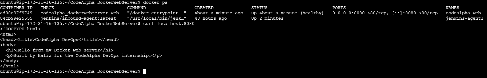
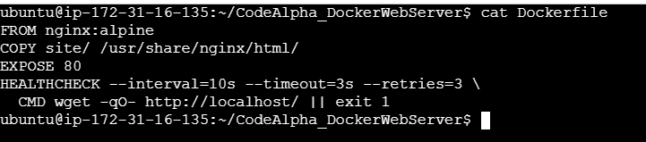
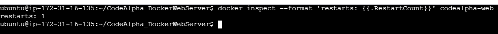
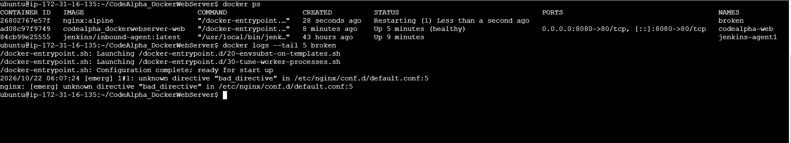
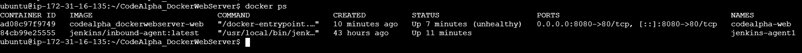

CodeAlpha_DockerWebServer


A web server running inside Docker containers, built for Task 4 (Web Server using Docker) of the CodeAlpha DevOps internship.
The project serves a small web page with nginx, packages it as my own image with a health check, runs it with Docker Compose and an automatic restart policy, and includes a hands-on troubleshooting walkthrough where I break the server on purpose and fix it.
Author: Hafiz Muhammad Azeem (@hafizmazeem)
What this task covers
Task goal	What I did
Docker containerization basics	Ran nginx in a container, then built my own image from a Dockerfile
Deploy and manage a web server in containers	Served my own page, mapped host port 8080 to container port 80, ran it with Docker Compose
Container lifecycle and commands	`run`, `stop`, `start`, `rm`, `ps`, `logs`, `exec`, `stats`, `inspect`
Monitor container health and troubleshoot	Added a `HEALTHCHECK`, then diagnosed a port conflict, a crash loop and an unhealthy container
Deployment best practices	Small base image (`nginx:alpine`), content baked into the image, health check, restart policy, fixes done by recreating containers
Project structure
```
CodeAlpha_DockerWebServer/
├── Dockerfile
├── docker-compose.yml
├── site/
│   └── index.html
├── troubleshooting/
│   └── broken.conf
├── screenshots/
└── README.md
```
Run it
```bash
git clone https://github.com/hafizmazeem/CodeAlpha_DockerWebServer.git
cd CodeAlpha_DockerWebServer
docker compose up -d --build
curl localhost:8080
```
Stop and remove it with `docker compose down`.
How it works
Dockerfile
```dockerfile
FROM nginx:alpine
COPY site/ /usr/share/nginx/html/
EXPOSE 80
HEALTHCHECK --interval=10s --timeout=3s --retries=3 \
  CMD wget -qO- http://localhost/ || exit 1
```
`FROM nginx:alpine` uses a small nginx base image.
`COPY` bakes my page into the image, so it runs anywhere without needing a folder on the host.
`HEALTHCHECK` makes Docker request the page every 10 seconds. Three failures in a row mark the container `unhealthy`.
docker-compose.yml
```yaml
services:
  web:
    build: .
    container_name: codealpha-web
    ports:
      - "8080:80"
    restart: unless-stopped
```
`ports` maps port 8080 on the host to port 80 in the container.
`restart: unless-stopped` restarts the container if it crashes or the machine reboots.
Demo and proof
1. Running and healthy
`docker ps` shows the container as `(healthy)`, and `curl` returns my page.

2. The Dockerfile with the health check

3. Restart policy
I crashed nginx from inside the container with `docker exec codealpha-web kill 1`. Docker restarted it automatically, and the restart count went to 1.

> Note: `docker kill` does not trigger the restart policy, because Docker treats it as a manual stop. The policy is for crashes, which is why I used `kill 1` inside the container instead.
4. Crash loop: reading the logs
A bad config file made nginx exit on every start, and the restart policy kept retrying (`Restarting` in the status column). The logs show the exact cause and line.

5. Running, but unhealthy
I deleted the page inside the running container. The process stayed up, but the health check failed, so Docker marked the container `(unhealthy)`.

Troubleshooting walkthrough
Failure	How it shows up	Cause	Fix
Port conflict	`port is already allocated` on `docker run`; the new container stays in `Created`	Another container already uses host port 8080	Use a different host port (for example `-p 8081:80`) and remove the dead container
Crash loop	`docker ps` shows `Restarting`; `docker logs` shows `unknown directive "bad_directive"`	Invalid nginx config in the mounted file	Remove the bad line, then remove and recreate the container
Unhealthy container	`docker ps` shows `(unhealthy)` while the container is still `Up`	`index.html` was deleted inside the container, so the health check gets an error	Recreate the container from the image: `docker compose up -d --force-recreate`
Reproduce the crash loop (the config file in this repo has the mistake on purpose):
```bash
docker run -d --name broken -p 8082:80 --restart unless-stopped \
  -v $(pwd)/troubleshooting/broken.conf:/etc/nginx/conf.d/default.conf:ro nginx:alpine
docker ps
docker logs --tail 5 broken
docker rm -f broken
```
Reproduce the unhealthy state:
```bash
docker exec codealpha-web rm /usr/share/nginx/html/index.html
sleep 45
docker ps
docker compose up -d --force-recreate
```
Useful commands
```bash
docker ps                      # running containers
docker ps -a                   # all containers, including stopped ones
docker logs <name>             # output of the container
docker exec -it <name> sh      # open a shell inside it
docker stats --no-stream       # CPU and memory use
docker inspect <name>          # low-level details
docker inspect --format '{{.State.Health.Status}}' <name>   # health status
docker stop <name> && docker start <name>
docker rm -f <name>
```
What I learned
Running is not the same as healthy. A container can be up while the app inside it is failing. The health check is what shows that.
Read the logs first. The status tells me something is wrong, and the logs tell me what and where.
Containers are disposable. I fixed problems by recreating the container from the image instead of patching a running one.
A restart policy retries, it does not repair. It brings back a crashed container, but a broken config keeps crashing until it is fixed.
Author
Hafiz Muhammad Azeem
GitHub: github.com/hafizmazeem | LinkedIn: linkedin.com/in/hafiz-muhammad-azeem-205190287
